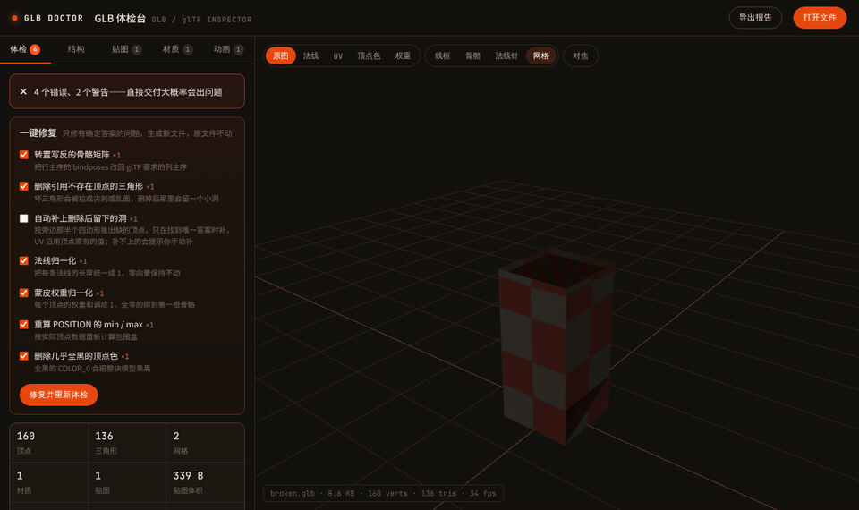
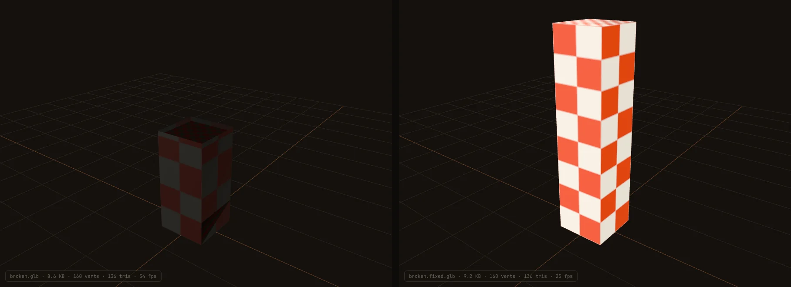
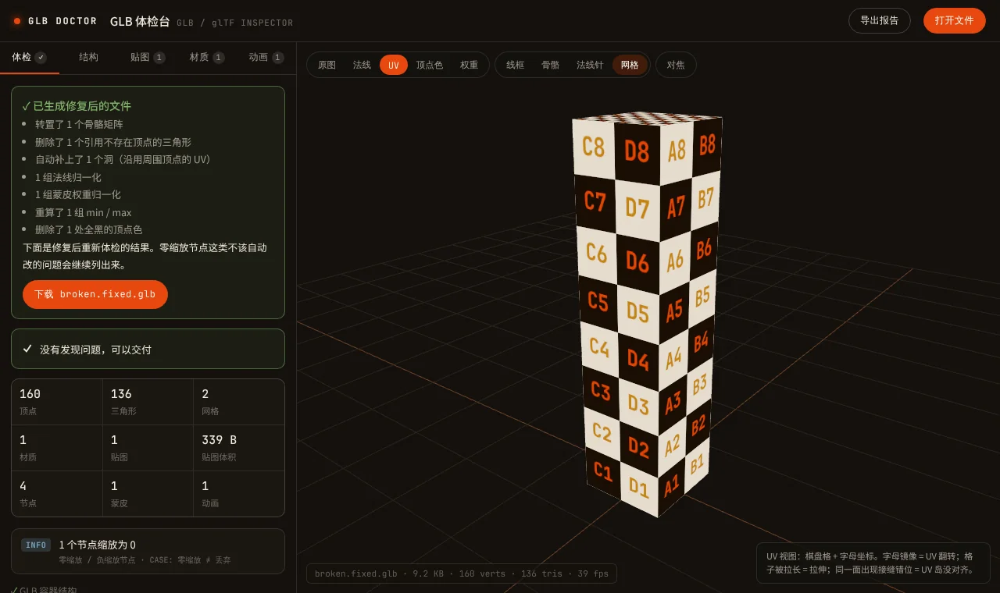
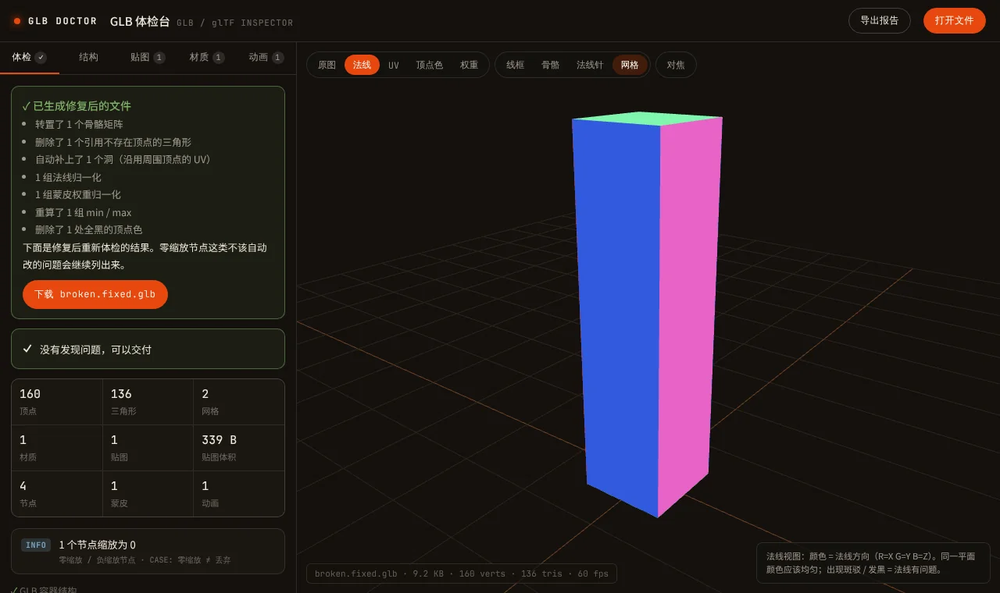

<div align="center">

# GLB Doctor

### Find and fix broken glTF / GLB exports in your browser, before they break your game.

**English** · [简体中文](README.zh-CN.md)

[](LICENSE)
[](https://www.khronos.org/gltf/)
[](#privacy)
[](#privacy)

**[Open GLB Doctor](https://yigenjiao.github.io/glb-doctor/)** · **[Try a broken sample](https://yigenjiao.github.io/glb-doctor/?sample=broken.glb)**



</div>

---

## Why

You export a model from Blender, Unity or your own script. It looks fine there. Then you drop it into three.js and it turns black, flies apart when the animation plays, or refuses to load with `Failed to load buffer`.

The bug is in the bytes, not in the mesh you see. GLB Doctor reads the raw glTF data, tells you what is wrong in plain language, points at the mesh that is broken, and **fixes the problems that have a definite fix**. Then it re-checks the result so you can see it is clean.

It complements the official [Khronos glTF-Validator](https://github.khronos.org/glTF-Validator/): the validator checks spec conformance; GLB Doctor focuses on the export mistakes that actually show up in production, explains them, and repairs them.

## What it catches

| Problem | What you see in the engine |
| --- | --- |
| Inverse bind matrices written row-major | The character explodes or collapses as soon as it is skinned |
| Accessor data written as float64 but declared FLOAT | Garbage geometry, NaN everywhere, no useful error |
| `COLOR_0` multiplied into the base color | Blue textures tinted red, whole meshes turning black |
| `buffers[0].uri` left inside a GLB | `Failed to load buffer` in three.js and Blender |
| Indices pointing past the vertex count | Stretched shards and broken faces |
| Non-unit normals, missing `min` / `max` | Lighting too bright or too dark, meshes culled at some angles |
| Skin weights not summing to 1, joint index overflow | Vertices scaling or flying off during animation |
| Zero-scale nodes, texture format and size issues | Missing props, textures failing on mobile GPUs |

Every finding comes with the cause, a suggested fix, and a button that frames the broken mesh in the viewport.

## What it fixes

Tick what you want and press **Fix & re-check**. GLB Doctor writes a new `.glb`, re-inspects it, and offers it for download. Your original file is never modified.

- Transpose row-major bind matrices back to column-major
- Re-encode float64 data as float32
- Remove triangles that reference missing vertices, and optionally **fill the hole** when there is exactly one correct answer (the missing corner is predicted from the neighboring quad; UVs come from the existing vertices)
- Normalize normals and skin weights (integer weights are re-quantized so they sum exactly)
- Recompute `POSITION` min / max
- Drop the stray `uri` from a GLB buffer
- Remove black or tinting `COLOR_0` (tinting removal is off by default, because foliage often relies on vertex color)

It deliberately leaves alone anything without a single right answer, such as zero-scale nodes, which are often hidden on purpose.



## Inspection views

UV checker with lettered tiles (spot flips and stretching), normal shading, vertex-color only, skin-weight heatmap per bone, wireframe, skeleton and normal needles.

<p>


</p>

## Privacy

Everything runs locally in your browser. Files are parsed with JavaScript on your machine and are **never uploaded**. The app is a single HTML file.

## Run it yourself

```bash
git clone https://github.com/yigenjiao/glb-doctor.git
cd glb-doctor
python -m http.server 8000      # or: npx serve .
```

Then open http://localhost:8000. A local server is needed because browsers block loading the sample files from `file://`.

`samples/make_samples.py` regenerates the healthy and the deliberately broken sample (needs NumPy).

## Known limitations

- The interface is currently in **Chinese**. An English interface is the next thing on the list.
- One-click fixes work on single `.glb` files. For `.gltf` + `.bin`, export as `.glb` first.
- Geometry checks skip Draco / Meshopt compressed primitives (they still render).
- KTX2 / Basis textures are listed but not decoded.

## Roadmap

- [ ] English interface
- [ ] Batch mode: drop a folder, get one report
- [ ] Command-line version for CI pipelines

## Contributing

The most useful contribution is a GLB that breaks something. Open an issue with the file (or a minimal repro) and what you saw in your engine, and I will add a check for it.

## Author

Made by **Bowen**, a game artist with ten years in the industry, who restores 3D assets from shipped builds for a living and kept hitting these bugs. More at [yigenjiao.github.io/Bowen](https://yigenjiao.github.io/Bowen/).

## License

[MIT](LICENSE). Bundles [three.js](https://threejs.org/) r169 (MIT) in `vendor/three`, so the app works without any CDN.
