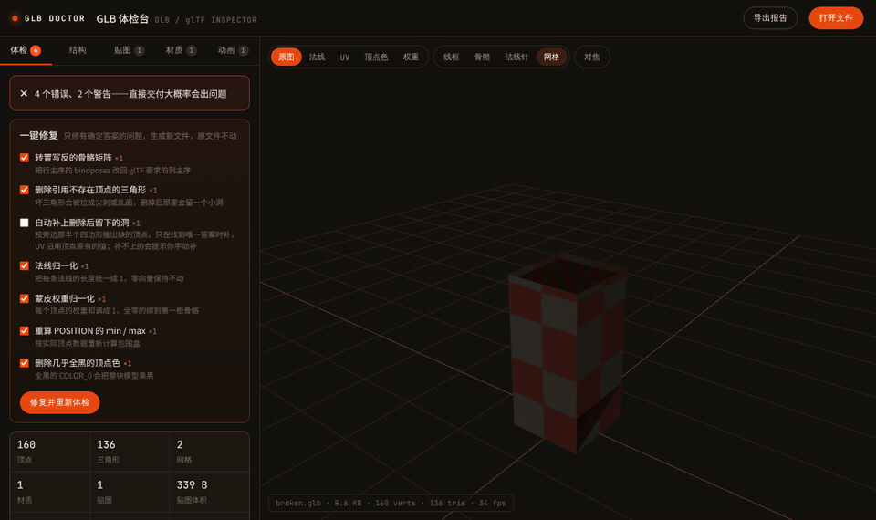
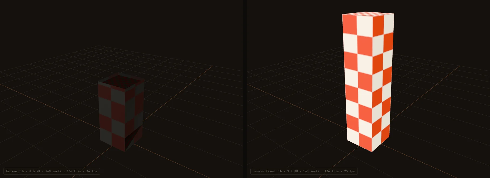
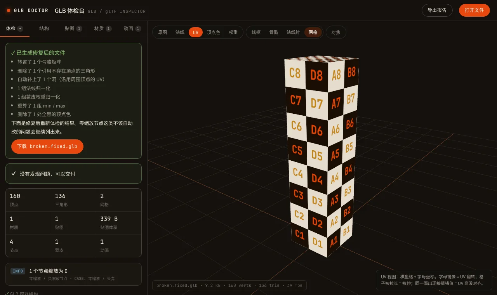
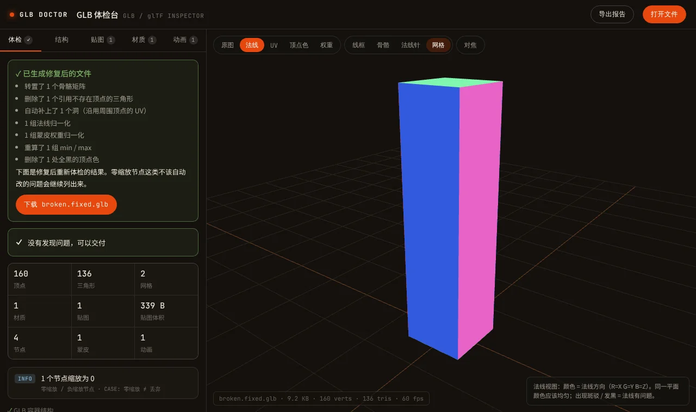

<div align="center">

# GLB 体检台 · GLB Doctor

### 在浏览器里查出并修好 glTF / GLB 导出的坑，别等它在游戏里出事。

[English](README.md) · **简体中文**

[](LICENSE)
[](https://www.khronos.org/gltf/)
[](#隐私)
[](#隐私)

**[打开体检台](https://yigenjiao.github.io/glb-doctor/)** · **[看它怎么修一个坏样本](https://yigenjiao.github.io/glb-doctor/?sample=broken.glb)**



</div>

---

## 为什么做这个

模型从 Blender、Unity 或者自己写的脚本导出来，在软件里看着好好的。一放进 three.js，要么整块发黑，要么一播动画就散架，要么直接报 `Failed to load buffer`。

问题不在你看到的网格上，而在文件里的数据上。GLB 体检台直接读 glTF 的原始数据，用大白话告诉你哪里坏了、坏在哪个模型上，**有确定修法的问题直接一键修好**，修完再自动复查一遍。

它和官方的 [Khronos glTF-Validator](https://github.khronos.org/glTF-Validator/) 互补：官方校验器查的是“合不合规范”，体检台查的是实际导出时最常见的坑，并且帮你修。

## 能查出什么

| 问题 | 在引擎里的表现 |
| --- | --- |
| 骨骼矩阵（inverseBindMatrices）行列写反 | 角色一蒙皮就炸开或塌掉 |
| 数据按 float64 写入，却声明成 FLOAT | 几何全乱、满屏 NaN，报错信息还指不到这里 |
| `COLOR_0` 和贴图相乘 | 蓝色贴图被染红，整块模型发黑 |
| GLB 里的 `buffers[0]` 残留 `uri` | three.js、Blender 报 `Failed to load buffer` |
| 索引超出顶点数 | 拉长的尖刺和破面 |
| 法线没归一化、缺 `min` / `max` | 光照偏亮偏暗，某些角度模型被剔除 |
| 蒙皮权重和不为 1、骨骼索引越界 | 动画时顶点整块缩放或乱飞 |
| 零缩放节点、贴图格式与尺寸 | 道具“消失”，移动端贴图加载失败 |

每条问题都写明原因和修法，点一下就能在视口里定位到出问题的模型。

## 能修什么

勾选要修的项，点“修复并重新体检”。工具会生成一个新的 `.glb`，自动复查，然后让你下载。原文件不会被改动。

- 把行主序的骨骼矩阵转回列主序
- 把 float64 数据转回 float32
- 删除引用不存在顶点的三角形，可选**自动补洞**：只在答案唯一时补，按旁边那半个四边形推算出缺的顶点，UV 沿用顶点原有的值
- 法线、蒙皮权重归一化（整数权重量化后补齐误差，保证和正好为 1）
- 重算 `POSITION` 的 min / max
- 删除 GLB buffer 里多余的 `uri`
- 删除全黑或会染色的 `COLOR_0`（“会染色”这项默认不勾，因为树木、花丛常常靠顶点色上色）

没有唯一正确答案的问题，比如零缩放节点（很多是故意隐藏的），工具只报告，不乱改。



## 检查视图

带字母的 UV 棋盘格（一眼看出翻转和拉伸）、法线着色、只看顶点色、按骨骼显示的蒙皮权重热力图、线框、骨骼、法线针。

<p>


</p>

## 隐私

全部在你的浏览器里运行。文件在你自己的电脑上用 JavaScript 解析，**不会上传到任何地方**。整个工具就是一个 HTML 文件。

## 本地运行

```bash
git clone https://github.com/yigenjiao/glb-doctor.git
cd glb-doctor
python -m http.server 8000      # 或者：npx serve .
```

然后打开 http://localhost:8000。需要起一个本地服务器，因为浏览器不允许直接从 `file://` 读取样本文件。

`samples/make_samples.py` 可以重新生成健康样本和故意埋了坑的坏样本（需要 NumPy）。

## 已知限制

- 一键修复目前只支持单个 `.glb` 文件。`.gltf` + `.bin` 请先导出成 `.glb`。
- Draco / Meshopt 压缩过的几何会跳过逐顶点检查（渲染不受影响）。
- KTX2 / Basis 贴图会列出来，但不解码。

## 计划

- [ ] 英文界面
- [ ] 批量模式：拖进一个文件夹，出一份总报告
- [ ] 命令行版本，接进 CI 流水线

## 参与

最有用的贡献，是一个能把引擎搞坏的 GLB。开一个 issue，附上文件（或者最小复现），再说说你在引擎里看到了什么，我会为它加一条检查。

## 作者

**Bowen（一根蕉）**，做了十年游戏美术，专门从成品包里还原 3D 资产，这些坑基本都踩过。更多见 [yigenjiao.github.io/Bowen](https://yigenjiao.github.io/Bowen/)。

## 许可证

[MIT](LICENSE)。仓库内置了 [three.js](https://threejs.org/) r169（MIT 许可证，位于 `vendor/three`），不依赖任何 CDN，国内网络也能打开。
